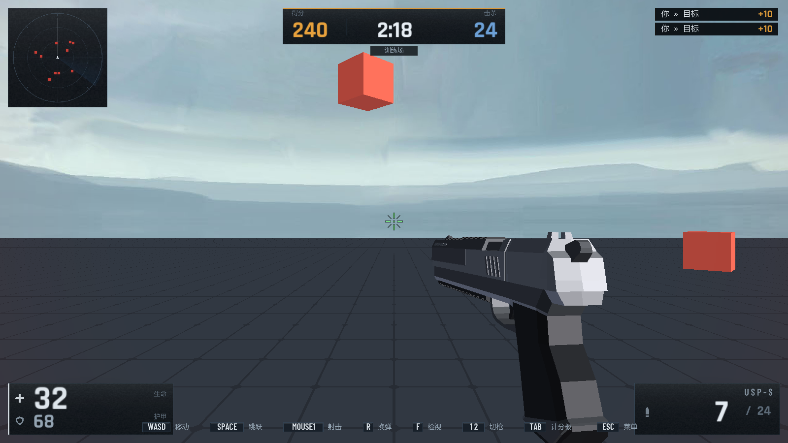
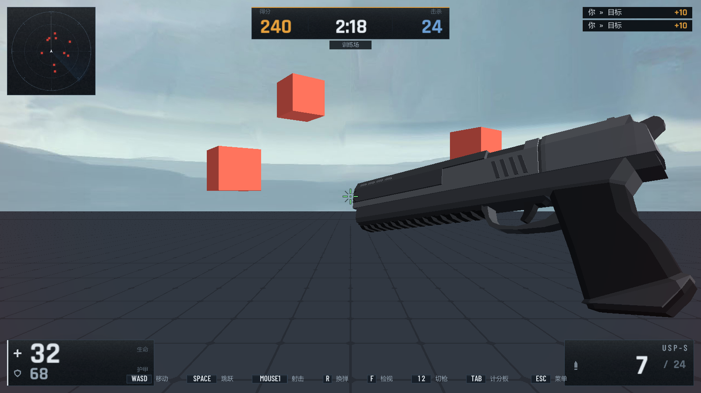
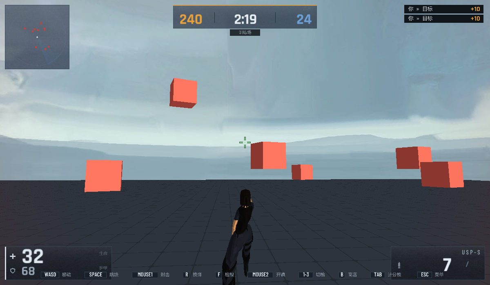

# 射击 · ursina-shooter

一个基于 [ursina](https://www.ursinaengine.org/) 的极简 3D 射击练习场，外加一个用 PySide6 写的**战术风格客户端启动器**：游客登录、模式选择、局域网联机房间（TCP 25250）、房主控制台与作弊指令。

> **许可证：PolyForm Noncommercial License 1.0.0 —— 仅限非商业用途。**
> 个人学习、研究、娱乐、教学与非营利组织使用均被允许；任何商业用途（含商用产品集成、付费分发、商业服务）需另行获得作者授权。详见 [LICENSE](LICENSE)。

---

## 功能一览

### 游戏（`射击.py`）
- **五件武器（CC0 模型）**：USP 手枪、沙漠之鹰、AK-47（全自动）、AWM 狙击枪（右键开镜）、刺刀，
  GLB 载入、材质重映射、`F` 键程序化检视
- **背包规则**：每人限带 匕首 + 副武器 + 主武器 各一件；`1`/`2`/`3` 对应 主武器 / 副武器 / 匕首，滚轮在已装备武器间循环
- **武器选择商店**：开局自动弹出、局内按 `B` 随时打开；主武器（AK/AWM）与副武器（USP/沙鹰）自由挑选，
  价格全部为 0（不启用经济系统）；训练场 / 单挑 / 团队全模式可用
- **备弹无限**：所有武器备弹显示 ∞，弹匣打完换弹即可，无需补给
- **每武器弹道手感**：后坐力（视角**向上**踢 + 按武器类型分级：手枪轻快 / 步枪连发上抬 / 狙击猛顶慢回）
  与子弹散布（基础角 + 连射热量 + 移动惩罚 + 开镜精度倍率），准星扩散实时反映精度状态
- **狙击开镜**：AWM 右键按住开镜（FOV 平滑过渡、镜内灵敏度随倍率降低、圆形镜片遮罩）
- **人物模型（CC0）**：Quaternius Soldier 士兵（24 条骨骼动画）装配在玩家实体上，
  panda3d Actor 驱动待机（持枪指向）/ 跑动（持枪跑）骨骼动画；第一人称隐藏自身模型，
  按 `V` 切第三人称可见；人机复用同一模型并按阵营着色
- **训练场木偶人靶**：木制人形靶（头 / 胸 / 躯干 / 四肢 / 底座），分部位伤害判定，
  一半固定一半巡航；被击倒后倒地翻滚并自动重生；团队模式刷蓝队染色木偶
- **分部位伤害（三区制）**：头部 ×4.0 / 胸+躯干 ×1.25 / 四肢 ×0.75，
  木偶人与玩家角色共用同一套倍率与结算入口（`combat.zone_damage`）；
  玩家被击中的部位按命中点离地高度划分（≥1.55m 头 / ≥0.75m 躯干 / 其下肢体）
- **人机（Bot）补齐**：PvP 单挑与团队竞技支持人机补齐房间——房主大厅
  「人机补齐」按钮按难度（简单 / 普通 / 困难）填满两队空位，控制台
  `bot add 红|蓝 n [难度]` 同样可用；人机会搜索玩家、按反应延迟与角度
  误差开火（高斯弹道），被击倒 3 秒重生；本地单挑/团队模式自动生成对手人机
- **服务器端反作弊验证**：对局内命中走 `hit_claim` 上报，服务器按武器配置表
  独立计算伤害与射速节流（超频 / 改伤害 / 鞭尸 / 伪造身份一律拒绝），
  权威比分 `score_update` 广播全员；被拒声明会在游戏内横幅提示
- **毛玻璃 UI**：所有面板背景为半透明磨砂玻璃（低分辨率离屏缓冲 + GLSL 采样），
  任意分辨率下采样正确、文字对比度充足；不支持时自动退化为纯色面板
- **对战地图（CC-BY）**：启动器选「单挑」或「团队竞技」即加载封闭竞技场（50×100 米，
  自动生成碰撞体）；单挑为点对称出生点，团队模式红蓝双方底线横排出生、
  击杀蓝队目标计分、**先达到 50 分判胜**
- **CS:GO 风格 HUD**：左下血量/护甲、右下弹药与武器名、顶部比分与计时、左上雷达、右上击杀提示、底部按键提示条
- **命中反馈**：绿色十字准星常驻；红色命中标记仅在子弹命中物体或敌人时短暂闪现
- **音效**：每把武器使用**独立音色枪声**（USP 清脆短促 / 沙鹰厚重炮吼 / AK 连发
  脆响+拉栓 / AWM 低频轰鸣+回声尾 / 匕首挥砍扫掠），另有命中标记、换弹起始、
  装弹到位（CC0 真实录音加工）、切枪、切刀音效；全部可自由商用，
  授权明细见 `sfx/LICENSE.txt`，生成脚本 `tools/make_sfx.py` 可复现
- **输入法屏蔽**：游戏窗口创建时自动把输入法上下文摘除（`ImmAssociateContext`），
  中文输入法不再截获 R/B/F 等按键；只影响游戏窗口，其他程序不受影响，退出自动恢复
- **真实数值系统**：血量 / 护甲（按 CS:GO 规则吸收一半伤害）/ 弹匣与无限备弹 / 换弹进度 / 摔落伤害 / 死亡与重生
- **暂停菜单**：左侧导航 + 右侧内容（本局数据 / 设置 / 退出），设置项即时生效并写回 `settings.json`
- **Tab 计分板**：阵营分栏、本机行高亮、空槽位提示
- 第一人称移动（WASD / 空格跳跃 / 左键射击 / R 换弹 / F 检视 / 1~3 切枪 / B 商店 / 右键开镜 / V 第三人称 / Tab 计分板 / ESC 暂停）
- 打靶计分、目标方块随机刷新（伤害制：按武器伤害扣血、打空血才计分）、枪口闪光与后坐力动效
- 读取启动器写入的 `settings.json`（分辨率 / 全屏 / 灵敏度 / 音量）与 `scores.json`（最高分）
- 兼容 ursina 7.x / 8.x（颜色 API、中文字体加载、暂停时光标状态均已适配）

### 启动器（`launcher.py` + `net_ui.py` + `room_net.py`）
- **游客登录**：输入昵称即进入，昵称持久化并可随时切换；邮箱登录页签已预留
- **环境自检**：探测可用 Python、ursina / panda3d 版本、中文字体与音效文件，异常时给出修复入口
- **模式选择**：训练场（本地单机）/ 单挑 1v1 / 团队竞技 5v5、10v10
- **局域网联机**：创建房间（监听 TCP 25250、可设密码、预配置目标比分与时长）或加入房间（扫描本网段所有 IP 的 25250 端口，也可手输房主 IP）
- **房间大厅**：红蓝分队、成员同步、房主开始/锁定/改密码，加入方等待开始信号自动进入游戏
- **房主控制台**：比赛控制、玩家作弊、机器人补位、房间管理四组命令，作弊指令始终向全员广播
- **工程化**：配置持久化、game 进程托管与日志、崩溃提示、单实例锁、一键打包 exe

---

## 运行要求

| 组件 | 版本 | 说明 |
|------|------|------|
| Python | 3.11 / 3.12 | 游戏端依赖 panda3d，目前**不支持 3.13+** |
| PySide6 | ≥ 6.5 | 启动器界面 |
| ursina | 7.x / 8.x | 游戏引擎（8.x 需 Python ≥ 3.12） |

```bash
pip install -r requirements.txt
python launcher.py          # 推荐：通过启动器进入
python 射击.py              # 也可直接运行游戏
```

启动器会自动在候选路径中寻找可用的 Python（已配置路径 → 游戏目录 `.venv` → 上级 `.venv` → 系统 Python 安装目录），无需手动指定。

---

## 游戏内界面（CS:GO 风格）

界面拆成三层，都是为了后续接联机时能单独替换：

| 模块 | 职责 |
|---|---|
| `ui_theme.py` | 配色、字体解析、程序化贴图（噪点/受光/辉光/暗角/雷达环/图标）、面板与按钮控件、锚点换算 |
| `hud.py` | 血量护甲、弹药、雷达、比分、击杀提示、准星与命中反馈 |
| `menu.py` | 暂停菜单（本局数据 / 设置 / 退出）与 Tab 计分板 |
| `combat.py` | 纯逻辑数值系统（血量/护甲/弹药/换弹/摔落伤害/回血） |

**设计要点**

- **尺寸统一用 900p 像素表达**：`ui_theme.px(n)` 把像素换算成 UI 单位（屏高 = 1），
  因此 1600×900、2560×1440、21:9 带鱼屏下观感一致；左右贴边靠 `ui_half_w()`（±aspect/2）锚定，窗口改比例会自动重排。
- **字体**：数字与英文用 Rajdhani / Barlow Condensed（窄体大写，最接近 CS:GO 观感），中文回退系统微软雅黑 / 黑体。
  Panda3D 对含中文的绝对路径加载失败，所以字体统一用 `fonts/xxx.ttf` 相对路径。
- **质感**：面板 = 深色底 + 顶部柔光 + 细噪点贴图 + 1px 描边 + 角标；噪点贴图在运行时用 Pillow 生成到 `ui_cache/`，不占仓库体积。
- 素材都是程序化生成的矩形/圆环/渐变，无任何受版权保护的商业素材。

**操作**

| 按键 | 作用 |
|---|---|
| WASD / 空格 | 移动 / 跳跃 |
| 左键 | 射击（半自动按住只打一发；连续射击会扩大准星扩散；拿刀时是挥砍） |
| 右键（按住） | 狙击开镜（AWM；镜内灵敏度随倍率降低） |
| R | 换弹（弹匣空时开火会自动换弹；备弹无限；近战武器无需换弹） |
| F | 检视武器（再按一次提前收枪） |
| 1 / 2 / 3 或滚轮 | 切换 主武器 / 副武器 / 匕首（滚轮在已装备武器间循环） |
| B | 打开 / 关闭武器商店（价格全部为 0） |
| V | 第一 / 第三人称切换（第三人称可见人物模型与动画） |
| Tab（按住） | 计分板 |
| ESC | 关闭商店 / 暂停菜单 |
| F1 / F2 | 自测：扣 22 血 / 补满血甲 |

**自检**

```bash
python 射击.py --selftest                          # 开火/半自动连发/备弹无限/配装/商店/后坐/检视/开镜/人物/暂停/计分板/死亡重生全链路
python 射击.py --selftest --map duel               # 单挑地图模式自检
python 射击.py --selftest --map team               # 团队竞技模式自检（出生点/阵营色/胜利判定）
python 射击.py --shot hud.png --view hud           # 离屏出图（hud / pause / settings / score / quit）
python 射击.py --shot ak.png --view ak             # 武器特写（usp / deagle / ak / awm / knife / scope / inspect）
python 射击.py --shot shop.png --view shop         # 武器商店界面
python 射击.py --shot third.png --view third       # 第三人称人物模型
python 射击.py --shot hit.png --view hit           # 命中标记闪现
python 射击.py --shot duel.png --view hud --map duel        # 加载 1v1 单挑地图出图
python 射击.py --shot wide.png --view hud --size 2560x1080  # 验证超宽屏锚点与毛玻璃采样
```

---

## 武器系统（模型 / 视图模型 / 检视动画）

### 引擎与渲染管线

引擎是 **ursina 8.x（底层 Panda3D）**。武器是 GLB 格式，通过
**panda3d-gltf**（`gltf.load_model`）在运行时载入——它返回的是 `ModelRoot`，
要自己包一层 `NodePath` 才能挂进场景图。

项目**没有引入 simplepbr**：HUD 是纯色 UI、场景是 unlit 方块，套一层 PBR
会把整套配色重做一遍，而 2000 面的低模上也看不出金属反射的差别。
所以 `weapons/loader.py` 走的是「材质翻译」路线：读 glTF 的
`pbrMetallicRoughness.baseColorFactor`，按材质名重映射成枪械配色
（glTF 里这些颜色接近纯黑，直接用会糊成一团），再生成 Blinn-Phong 材质，
顺手把 `alphaMode=BLEND` 带来的半透明清掉（否则枪身会透）。

灯也不打全场：一盏环境光 + 两盏方向光挂在视图模型节点下，**只照武器**，
场景和 HUD 完全不受影响。

### 目录与职责

```
weapons/
  config.py     武器目录：五件套数值、弹道（后坐/散布/开镜）、模型路径、手持姿态、检视/挥砍关键帧（纯数据）
  anim.py       关键帧采样、一次性动画轨道 Track、指数缓动 Spring（纯数学）
  loader.py     GLB 载入 + 材质重映射（keep_colors 保留原色）+ 居中归一化
  viewmodel.py  WeaponModel / Viewmodel：装备、切枪、检视、后坐、换弹、挥砍
  models/       usp / deagle / ak47 / awm / bayonet 五个 GLB（均为 CC0）
  LICENSES.md   五个模型的出处与 CC0 授权说明
```

### 层级设计（为什么动画不会「转到背后去」）

```
camera
└ viewmodel（补光灯也挂在这里）
  └ WeaponModel（容器）  位置 = 基础位置 + 动画位移，旋转 = 动画角度
    └ pivot              静态朝向 + 尺寸（模型已归一化成最长边 1）
      └ node             GLB 网格，几何中心在 pivot 原点
        └ muzzle         枪口，挂火光
```

旋转必须作用在**武器自身**的位置上（容器原点 = 枪身中心），否则绕光轴
转 90° 会让枪甩到镜头背后、直接看不见——这是调检视动作时踩过的坑，
`tests_weapons.py` 里用「动画偏航 ≤ 60°」把它钉成回归用例。

### 姿态与尺度

- 模型自身前向是 `+X`、上方 `+Y`；`rotation_y = -100°` 把它转到镜头前方，
  多出的 10° 让枪口微微向内收敛、指向准心（和 CS:GO 的手持观感一致）。
- 归一化后按 `length` 缩放到手持尺寸（手枪 0.26、匕首 0.32 世界单位），
  位置在 `pos` 里直接写「镜头右下方多少米」。
- 想换枪只要往 `CATALOG` 里加一条配置 + 一个 GLB，不需要改代码。

### 检视（F 键）与其它程序化动作

没有骨骼动画资源，全部是程序化姿态叠加：

| 动作 | 实现 |
|---|---|
| F 检视 | 关键帧轨道：抬枪 → 侧倾看左侧 → 停一拍 → 翻到右侧 → 回正（手枪 2.1s / 匕首 1.8s），再按一次 `stop()` 提前收枪 |
| 开火 | `recoil` 标量（1→0 衰减）驱动后坐位移 + 枪口上跳，枪口火光 55ms |
| 换弹 | 跟随 `combat.Weapon.reload_progress` 的 `sin` 曲线下压外翻 |
| 挥砍 | 关键帧轨道：起手外撇 → 向左下划过 → 收回（0.34s），配合 2.6 米射线判定 |
| 切枪 | 下压 0.16s → 换模型 → 上抬 0.24s，期间禁止开火 |
| 走路 / 甩枪 | 位移速度驱动 bob 相位，鼠标速度驱动 sway，都是指数缓动 |

关键帧插值用 `smoothstep`（两端速度为 0），所以起停没有线性插值的机械感。

### 资源授权

武器模型全部为 **CC0 1.0（公共领域）**，来自 Quaternius 的 *Ultimate Guns Pack*，
可商用、无需署名。出处、直链与改动说明见 [`weapons/LICENSES.md`](weapons/LICENSES.md)。

| 模型 | 出处 | 用途 |
|---|---|---|
| `usp_pistol.glb` | https://poly.pizza/m/52kQzphmeF | USP 手枪 |
| `deagle_pistol.glb` | https://poly.pizza/m/Z7aOjJu583 | 沙漠之鹰 |
| `ak47_rifle.glb` | https://poly.pizza/m/K2lXTYFSLC | AK-47 |
| `awm_sniper.glb` | https://poly.pizza/m/i65hEldsw6 | AWM 狙击枪 |
| `bayonet_knife.glb` | https://poly.pizza/m/D81P2smzCy | 刺刀 |

单挑/团队地图 `maps/duel_arena.glb`（fps/tps map，作者 theking1322）为
**CC-BY 3.0** 授权——免费且允许商用，唯一义务是保留署名；
本项目在 [`maps/LICENSES.md`](maps/LICENSES.md)、`arena.py` 注释与本页保留了署名与来源链接。

人物模型 `characters/soldier.glb`（Quaternius 士兵，24 条骨骼动画）为
**CC0 1.0** 授权——可商用、无需署名；原作者 Quaternius（https://quaternius.com），
经 Cinevva CC0 角色库分发（https://app.cinevva.com/game-assets/free-3d-character-models），
许可文件与加工说明见 [`characters/LICENSE.txt`](characters/LICENSE.txt)。

音效（`sfx/`，授权明细见 [`sfx/LICENSE.txt`](sfx/LICENSE.txt)）：
- 绝大多数为本项目 Python 标准库程序合成的原创音频（等同 CC0）：每把武器
  独立音色的枪声、命中标记、换弹起始、切枪、切刀
- 一条 CC0 第三方素材加工：`reload_done.wav`（OpenGameArt *Gun Reload Sound
  Effects*，Brian MacIntosh，峰值归一化 + 边缘淡入淡出）







---

## 联机说明

```
房主：启动器内运行房间服务，监听 0.0.0.0:25250
      本机游戏进程连接 127.0.0.1:25250
加入方：扫描本网段所有 IP 的 25250（或手输房主 IP），
        成功后游戏进程直连 房主IP:25250
```

| | 房主（创建房间） | 加入方（加入房间） |
|---|---|---|
| 网络角色 | 服务端 + 玩家（权威端） | 纯客户端，不监听端口 |
| 25250 | 本机监听 | 主动连接房主 |
| 谁能开始 | 唯一，开始时向全员广播 | 只能等待开始信号 |
| 防火墙 | 需放行入站 TCP 25250 | 通常无需放行 |
| 退出影响 | 房间解散，全员回联机界面 | 仅自己离队 |

**连不上怎么办**
1. 确认双方在同一局域网（同一路由器 / 同一热点）。
2. 把房主机器的网络配置文件设为 **专用网络**（Windows 设置 → 网络和 Internet → 属性）；公用网络默认拦截入站。
3. 手动放行端口（管理员 PowerShell）：
   ```powershell
   New-NetFirewallRule -DisplayName "Shooting Room 25250" -Direction Inbound -Protocol TCP -LocalPort 25250 -Action Allow
   ```
4. 加入方仍连不上时，用 `ipconfig` 确认真实 IPv4，手动输入房主 IP（端口固定 25250，无需填写）。

---

## 控制台命令（仅房主）

在大厅点「打开控制台」即可输入，支持玩家名前缀匹配与 `all`。

**比赛控制**

| 命令 | 说明 |
|---|---|
| `score set red 5 blue 3` | 直接设置两队比分 |
| `score add blue 2` / `score reset` | 加分 / 清零 |
| `time 600` | 比赛时长（秒，0 = 无限时） |
| `end` / `restart` | 结束结算 / 重开一局 |

**玩家作弊**（始终全员广播）

| 命令 | 说明 |
|---|---|
| `god <玩家\|all>` / `god off` | 无敌开关 |
| `speed <玩家\|all> <倍数>` | 移动速度（0.5–5） |
| `damage <倍数>` | 全场伤害倍数（0.1–10） |
| `ammo inf on\|off` | 无限弹药 |
| `kill <玩家>` | 秒杀 |
| `tp <玩家> <x> <z>` | 传送 |
| `respawn <秒>` | 重生时间 |
| `bot add <红\|蓝> <n> [简单\|普通\|困难]` / `bot clear` | 机器人补位（可指定难度）/ 清空 |

**房间管理**

| 命令 | 说明 |
|---|---|
| `kick <玩家>` / `ban <玩家>` | 踢出 / 踢出并禁止再进 |
| `lock on\|off` | 锁定房间 |
| `pwd <新密码\|off>` | 修改 / 取消密码 |
| `say <消息>` | 全员广播 |
| `status` / `help` | 房间状态 / 命令帮助 |

---

## 项目结构

```
├── 射击.py                 # ursina 游戏本体（含联机参数接收、--selftest / --shot 自检）
├── ui_theme.py             # CS:GO 风格主题层：配色 / 字体 / 程序化贴图 / 毛玻璃面板控件
├── glass.py                # 毛玻璃背景层：低分辨率离屏缓冲 + GLSL 采样（失败退化为纯色）
├── hud.py                  # HUD：血量护甲、弹药、雷达、比分、击杀提示、准星、狙击镜遮罩
├── menu.py                 # 暂停菜单与 Tab 计分板
├── combat.py               # 数值系统：血量 / 护甲 / 弹药 / 换弹 / 近战 / 摔落伤害 / 分部位伤害倍率
├── arena.py                # duel_arena 地图：1v1 单挑 / 团队竞技共用，出生点与胜利分数（CC-BY 署名）
├── dummies.py              # 木偶人训练靶：头/胸/躯干/四肢分部位判定、巡航与倒地重生
├── bots.py                 # 人机：三档难度 AI（搜索/瞄准/高斯弹道）、阵营着色、击倒重生
├── maps/                   # duel_arena.glb + LICENSES.md（CC-BY 3.0 署名说明）
├── shop.py                 # 武器选择商店：开局弹出 + B 键呼出，主/副武器两栏，价格全部 0
├── characters/             # Quaternius Soldier 人物模型（CC0，含 LICENSE.txt，24 条骨骼动画）
├── sfx/                    # 音效：自制合成 + CC0 第三方素材（明细见 LICENSE.txt）
├── weapons/                # 武器：配置（槽位/后坐力分级）/ 动画数学 / GLB 载入 / 视图模型 + models/ + LICENSES.md
├── fonts/                  # Rajdhani + Barlow Condensed（OFL 1.1，含许可证文本）
├── launcher.py             # 启动器主程序：登录流程、环境自检、设置、进程托管
├── net_ui.py               # 登录 / 模式选择 / 建房 / 加入 / 房间大厅 / 控制台 UI（含人机补齐）
├── room_net.py             # 房间服务与客户端（纯标准库 TCP 实现，含命中声明验证入口）
├── anticheat.py            # 服务器端反作弊：射速节流 / 伤害权威计算 / 重生窗口 / 身份约束
├── game_net.py             # 游戏进程实时通道：hit_claim 上报与权威比分接收
├── app_style.py            # 启动器共享配色与控件样式
├── winfix.py               # 窗口状态保持补丁 + 输入法屏蔽（ImmAssociateContext）
├── tests_room.py           # 协议层测试：63 项（含反作弊验证 16 项）
├── tests_ui.py             # 大厅端到端测试：17 项
├── tests_combat.py         # 数值系统测试：44 项（含分部位伤害倍率）
├── tests_weapons.py        # 武器配置 / 动画数学 / GLB 资源测试：55 项
├── tests_window.py         # 窗口位置/尺寸保持 + 输入法屏蔽测试：15 项（含 bug 复现对照组）
├── assets/icon.(ico|png)   # 应用图标
└── dist/                   # 打包产物（未纳入版本库）
```

运行时生成的 `ui_cache/`（程序化 UI 贴图）与 `settings.json` / `scores.json` 均不入版本库。

协议：UTF-8、按行分隔的 JSON，端口固定 25250；消息类型详见 `room_net.py` 顶部注释。

## 测试

```bash
python tests_room.py    # 建房/密码/满员/扫描/全部命令/开始/踢人/解散
python tests_ui.py      # 大厅成员同步、控制台下发、双方自动启动、回大厅
python tests_combat.py  # 伤害与护甲公式、弹匣/换弹、回血、死亡与重生
python tests_weapons.py # 武器配置/关键帧合法性/动画插值/GLB 结构/近战数值
python tests_window.py  # 窗口拖动/缩放后鼠标锁定切换不再还原（含 bug 复现对照）
python 射击.py --selftest   # 游戏内 UI 与状态链路
```

## 打包为 exe

```bash
pip install pyinstaller
pyinstaller --noconfirm --onefile --windowed --name "射击启动器" ^
  --icon "assets/icon.ico" --distpath dist --workpath build --specpath build ^
  --exclude-module PySide6.QtWebEngineCore --exclude-module PySide6.QtQml ^
  --exclude-module PySide6.QtQuick --exclude-module tkinter launcher.py
```

推 tag（`v*`）时 GitHub Actions 会自动构建 exe 并附到 Release（见 `.github/workflows/release.yml`）。

---

## 已知限制

- **联机对战的位置/射击同步尚未接入**：当前对局内同步的是房间层信息与命中声明
  （击倒人机 / 被人机击中→服务器验证计分），玩家在世界中的实时位置仍是本机模拟；
  因此服务器能防"超频射击 / 改伤害 / 鞭尸刷分 / 伪造身份"，但无法检测透视、自瞄类
  外挂（需要完整位置同步与服务器端弹道模拟，属下一阶段）。
- 单挑需 2 人；人数不足时房主可在大厅点「人机补齐」用 BOT 填满两队（三档难度）。
- 人机运行在各端本地（视觉一致，比分经服务器权威验证）；我方人机随队巡航不主动交火。
- 游戏窗口内输入法已被摘除（无法输入中文）——游戏本身没有任何文本输入框，无实际影响。
- 引擎对 Python 3.13+ 暂无 panda3d 轮子，请使用 3.11 / 3.12。

## 第三方组件

- [ursina](https://github.com/pokepetter/ursina) — MIT
- [Panda3D](https://www.panda3d.org/) — BSD-3-Clause
- [PySide6 / Qt for Python](https://www.qt.io/qt-for-python) — LGPL-3.0
- [Rajdhani](https://fonts.google.com/specimen/Rajdhani) / [Barlow Condensed](https://fonts.google.com/specimen/Barlow+Condensed) — SIL Open Font License 1.1（许可证文本见 `fonts/OFL-*.txt`）
- [panda3d-gltf](https://github.com/Moguri/panda3d-gltf) — MIT（GLB 载入）
- 武器模型：Quaternius *Ultimate Guns Pack*（USP / 沙漠之鹰 / AK-47 / AWM / 刺刀）— **CC0 1.0 公共领域**，出处见 [`weapons/LICENSES.md`](weapons/LICENSES.md)
- 人物模型：Quaternius 士兵 — **CC0 1.0 公共领域**（经 Cinevva CC0 角色库分发），见 [`characters/LICENSE.txt`](characters/LICENSE.txt)
- 单挑地图：theking1322 *fps/tps map* — **CC-BY 3.0**（署名见 [`maps/LICENSES.md`](maps/LICENSES.md)）
- 装弹音效：*Gun Reload Sound Effects*（Brian MacIntosh，OpenGameArt）— **CC0 1.0**（加工后使用）

> 本项目未使用任何 Valve / CS:GO 的模型、贴图、音效或字体；界面是照着 CS:GO 的视觉语言自行绘制的。

界面风格参考 CS:GO，但**未使用任何 Valve 的素材或字体**：配色与版式是重新设计的，
图标、噪点、圆环、暗角等贴图全部由代码在运行时绘制；CS:GO 原字体 Stratum2 为商业字体，未包含在本项目中。

本项目仅使用上述组件，未修改其源码；分发衍生作品时请一并遵守其许可证。

## 免责声明

本项目为个人学习作品，与任何商业游戏无关；除声明的 CC0 / CC-BY 素材外不含任何受版权保护的商业素材。游戏音效全部由 `tools/make_sfx.py` 程序合成（其中装弹到位音基于 CC0 录音素材加工），启动器另有「补齐音效」功能生成早期版本的 `hit.wav`（现已不再被游戏引用）。

---

**License:** PolyForm Noncommercial 1.0.0 © 2026 OStarsO — 非商业使用免费，商业授权请联系作者。
